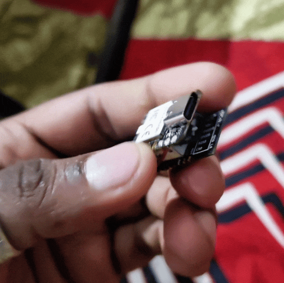
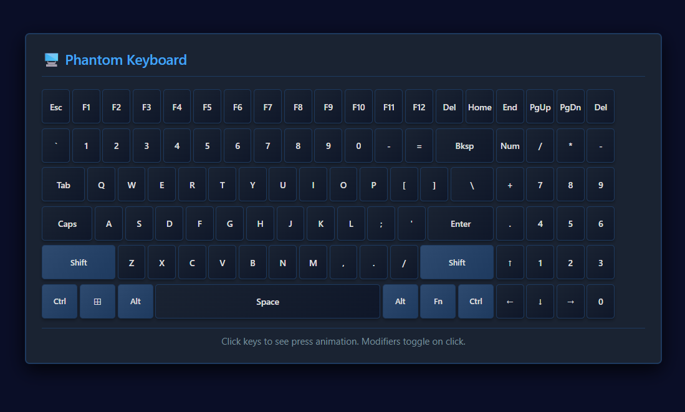
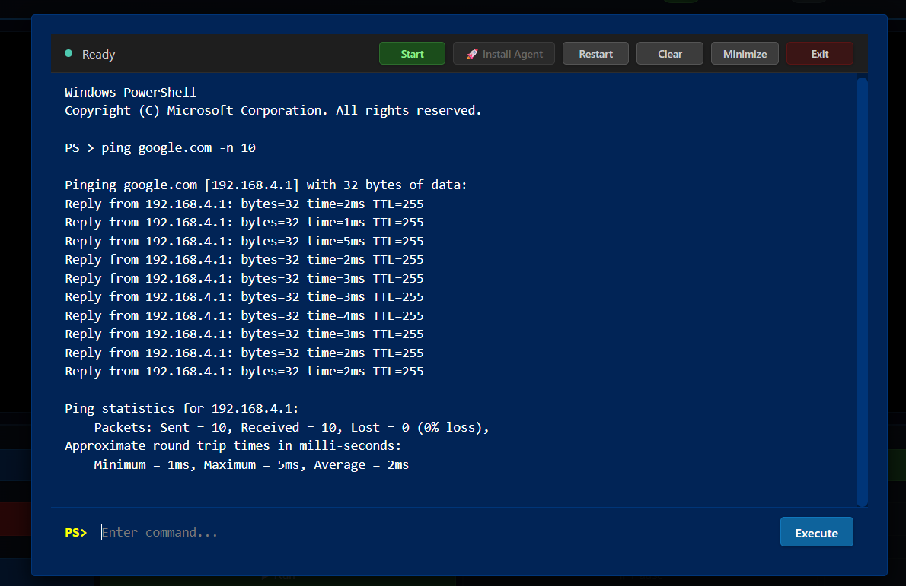
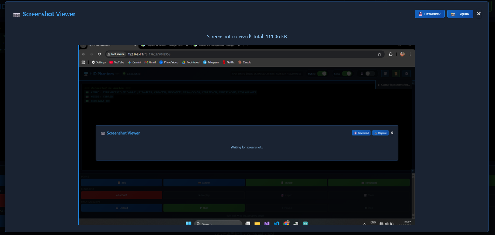
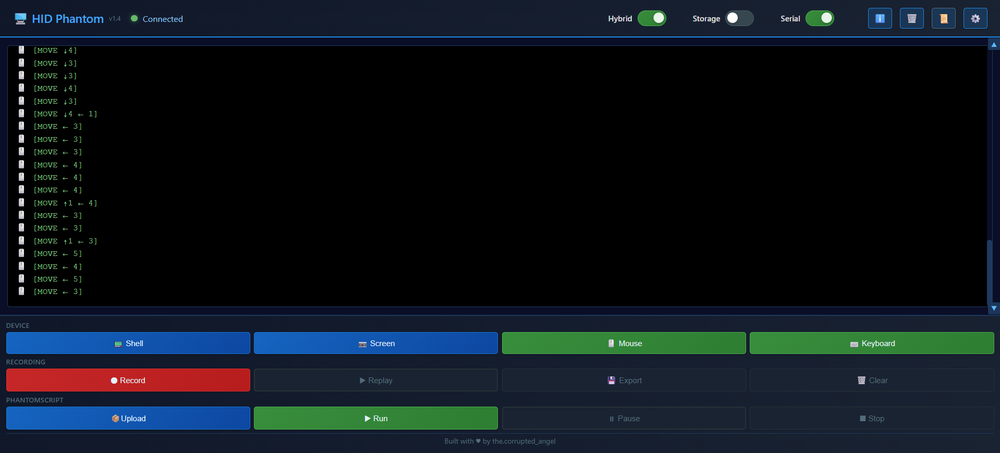

# HIDPhantom 👻

> *A thumb-sized, dual-MCU, USB HID Man-In-the-Middle (MITM) implant for offensive security research. Invisible to the OS. Lethal to air-gapped systems*


---

## What is HIDPhantom?

HIDPhantom is an original offensive hardware implant built for red team research, air-gap penetration studies, and HID attack surface exploration. It sits **physically between any USB HID device (keyboard/mouse) and the target host** — passthrough by design, invisible by default.

Unlike a standard BadUSB or Rubber Ducky, HIDPhantom does not announce itself. It **clones the PID/VID of the connected peripheral**, making itself indistinguishable from the legitimate input device to the OS, forensic tools, and USB enumeration utilities.

Built entirely on off-the-shelf modules for under ₹500 (~$5.5 USD).



---

## Architecture

```
┌──────────────────────────────────────────────────────────────────────┐
│                           HIDPhantom                                 │
│                                                                      │
│  [HID Device]──USB──► [RP2040 Dual-Core]  ◄─UART(921600)─► [ESP8266] │
│  (keyboard /           │                │                     │      │
│   mouse)          Core 1 (Host)    Core 0 (Device)      WiFi AP/STA  │
│                    │                │                     │          │
│                 USB Host        USB Device            Web UI/C2      │
│                 HID Capture     CDC Serial           OTA Updates     │
│                 PID/VID Clone   MSC Storage          HID Recording   │
│                                 RNDIS Network        Script Replay   │
│                                 HID Injection                        │
│                                      │                               │
│                                      ▼                               │
│                              [Host Machine]                          │
│                       (sees only the original HID device)            │
└──────────────────────────────────────────────────────────────────────┘
```

**RP2040 Core 1** runs the USB host stack — captures HID reports, extracts PID/VID, forwards to device stack.
**RP2040 Core 0** runs the USB device stack — presents spoofed descriptors, injects HID, provides CDC/MSC/RNDIS.
**ESP8266** provides wireless C2 interface, web UI, OTA firmware delivery, HID recording/replay, and remote shell access.

---

## Feature Set

### 🎭 PID/VID Identity Spoofing
HIDPhantom reads the Product ID and Vendor ID of the connected HID device at runtime and re-presents itself to the host using those exact identifiers. To the operating system, the device tree, and any USB forensic tool — only the legitimate device exists.

### ⏺️ HID Event Recording & Replay
Passively captures all HID events (keystrokes with inter-key timing, mouse movement vectors, click events) and stores them in flash. Replay is faithful — exact timing, exact trajectory. Useful for:
- Physical access simulation in red team exercises
- Session reconstruction in forensics research
- Automated interaction testing on locked/restricted systems



### 💀 Shell-over-Serial (Air-Gap Attack)
Delivers a shell on the target machine using only USB HID — no network, no pre-installed agent, zero user interaction required. The attack chain is fully self-contained:
1. HIDPhantom injects keystrokes to open a terminal or run dialog
2. Types a staged payload entirely via HID
3. Establishes a serial backdoor channel for interactive control

Works on air-gapped systems. No network required on the target.



### 📸 Screenshot-over-Serial
Exfiltrates the current screen state using only the HID channel — no file write, no network socket, no clipboard access. Fully covert screen capture with zero user interaction on the victim machine.



### 📡 OTA Firmware Updates
The ESP8266 module handles over-the-air firmware delivery for the RP2040. Push updated payloads wirelessly without physical access to the device.

### 🌐 Web-Based C2 Interface
ESP8266 hosts a wireless access point or connects to existing WiFi networks. Provides a web-based control panel accessible remotely for:
- Live HID event streaming and injection
- Recording management (start/stop/replay)
- Remote shell access via WebSocket
- Firmware updates and device configuration
- Real-time device status monitoring



### 🛡️ Dual-Firmware Unbrick System
Two firmware images are maintained in flash simultaneously — active and recovery. Inspired by ASUS dual-BIOS architecture:
- **Auto-downgrade:** bridge two pins on boot to restore the last known-good firmware from flash
- **Field-resilient:** a bricked or corrupted payload never permanently kills the device
- Recovery firmware is write-protected from the active partition

---

## Hardware

| Component | Role | Approx. Cost |
|-----------|------|-------------|
| Raspberry Pi RP2040 | USB HID engine, spoof layer, payload execution | ₹180 |
| ESP8266 12E | OTA, wireless C2, serial bridge | ₹120 |
| USB-A Male + Female connectors | Physical passthrough interface | ₹50 |
| Flash storage (onboard) | Firmware images + HID event log | — |
| misc | Housing and interconnects | ₹100 |
| **Total BOM** | | **< ₹500** |

The entire device fits in a thumb-drive form factor.

---


## Use Cases (Research Context)

- **Red team physical access simulation** — test what an adversary with 30 seconds of physical USB access can achieve
- **Air-gap research** — demonstrate data exfiltration and shell access in network-isolated environments
- **HID forensics** — record, analyse, and reconstruct physical input sessions
- **Security awareness demonstrations** — show defenders exactly how invisible USB threats behave
- **Embedded security research** — study USB HID stack behaviour across operating systems

---

## Project Status

| Module | Status |
|--------|--------|
| PID/VID spoof engine | ✅ Complete |
| HID passthrough (dual-core architecture) | ✅ Complete |
| Keystroke recording + replay | ✅ Complete |
| Mouse trajectory recording + replay | ✅ Complete |
| Shell-over-Serial (bidirectional CDC) | ✅ Complete |
| OTA firmware delivery | ✅ Complete |
| Dual-image unbrick system (GPIO trigger) | ✅ Complete |
| Web-based C2 interface (ESP8266 AP/STA) | ✅ Complete |
| RNDIS network bridging | 🔄 In Progress |
| Screenshot-over-Serial | ✅ Complete |
| Custom PCB (miniaturised form factor) | 📋 Planned |

---


## Research Goals

HIDPhantom was designed to answer a specific question:

> *"How much offensive capability can be packed into a transparent HID passthrough device that costs less than a cup of coffee — and that the OS cannot distinguish from a legitimate peripheral?"*

The answer, as it turns out, is: quite a lot.

Future research directions include miniaturising to a custom PCB, exploring HID-over-Bluetooth as a wireless attack surface, and investigating OS-level detection methodologies to understand what defenders would need to build to catch a device like this.

---

## ⚠️ Disclaimer

HIDPhantom is a **security research project** built for educational purposes, red team simulations in authorised engagements, and advancing understanding of USB HID attack surfaces.

**Use only on systems you own or have explicit written permission to test.** Deploying this device against systems without authorisation is illegal under the IT Act (India), the Computer Fraud and Abuse Act (USA), and equivalent laws globally.

The author takes no responsibility for misuse.

---

## Author

**Amal K. A.**  
Firmware Security Researcher · Offensive Hardware Developer  
[github.com/thecorruptedangel](https://github.com/thecorruptedangel) · [linkedin.com/in/amal-ka](https://linkedin.com/in/amal-ka)

---

*Built with curiosity, a soldering iron, and the firm belief that offensive capability should not be gated behind a $200 BOM.*